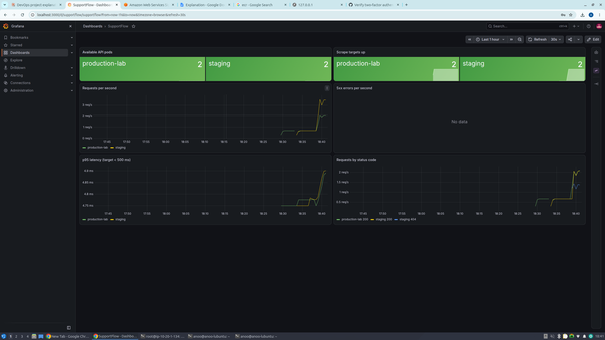

# Evidence: monitoring, dashboard and alert drill (Day 9, 2026-10-19)

## 1. Monitoring installed (`scripts/install-monitoring.sh`, kube-prometheus-stack 92.10.1)

    alertmanager-monitoring-kube-prometheus-alertmanager-0   2/2   Running
    monitoring-grafana-...                                   3/3   Running
    monitoring-kube-prometheus-operator-...                  1/1   Running
    monitoring-kube-state-metrics-...                        1/1   Running
    monitoring-prometheus-node-exporter-...                  1/1   Running
    prometheus-monitoring-kube-prometheus-prometheus-0       2/2   Running

Host memory after install: 2.6 GiB used of 7.6 GiB.
Grafana, Prometheus and Alertmanager use NodePorts that the security group does not open;
they were reached only through a Session Manager port-forwarding tunnel.

## 2. Prometheus can scrape the API (NetworkPolicy allows the monitoring namespace)

Both environments were redeployed with the same digest
(sha256:f8048fab35bae9719a94e97bbccb8abaa4074cac59cb087fcf55a7695f06b0dc) to apply the
updated NetworkPolicy:

    staging allows: kube-system monitoring
    production-lab allows: kube-system monitoring

Before staging was redeployed, its two targets showed `up=0` (blocked by the old policy),
which confirmed the NetworkPolicy is enforced. After redeploy:

    staging         supportflow-api-...-lqqk2  up=1
    staging         supportflow-api-...-b2dk8  up=1
    production-lab  supportflow-api-...-sxqh5  up=1
    production-lab  supportflow-api-...-cc5bl  up=1

Note: one production-lab redeploy at 17:27:52Z was recorded with `commit=unknown`
(a shell variable was not set because two pasted lines merged). It used the same digest;
it was redeployed at 17:33:03Z with the correct commit label.

## 3. Grafana dashboard "SupportFlow"

Under generated traffic (both environments):
- Available API pods: staging 2, production-lab 2. Scrape targets up: 2 and 2.
- p95 latency about 4.9 ms (target < 500 ms).
- 5xx errors: none (no data for the error counter).
- Status codes: 200 for both environments, plus 404 for deliberate requests to a missing ticket.

## 4. Alert drill: staging API scaled to 0

    17:44:22  kubectl -n staging scale deploy/supportflow-api --replicas=0
    17:45:22  SupportFlowNoAvailablePods  staging  pending
    17:46:22  SupportFlowNoAvailablePods  staging  firing
    Alertmanager: SupportFlowNoAvailablePods  staging  critical  active
    17:48:15  scaled back to 2 -> deployment "supportflow-api" successfully rolled out
              -> alert resolved

Time from outage to firing alert: 2 minutes (1 scrape interval + `for: 1m`).
production-lab was not affected.

## 5. Secret rotation (Grafana admin password)

The Grafana admin password was exposed in a working transcript, so it was rotated:
secret deleted, recreated with a new random value by `install-monitoring.sh`, Grafana
restarted. Login with the new password confirmed. Procedure: runbook 7.

## Limitations
- No notification receiver (email/Slack) is configured in Alertmanager; alerts are visible
  in Prometheus and Alertmanager only.
- Monitoring data is not persistent (3-day retention, no volume).
